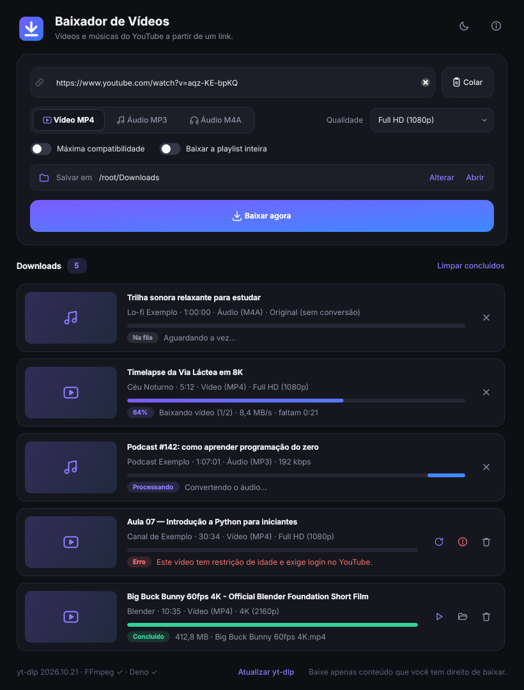
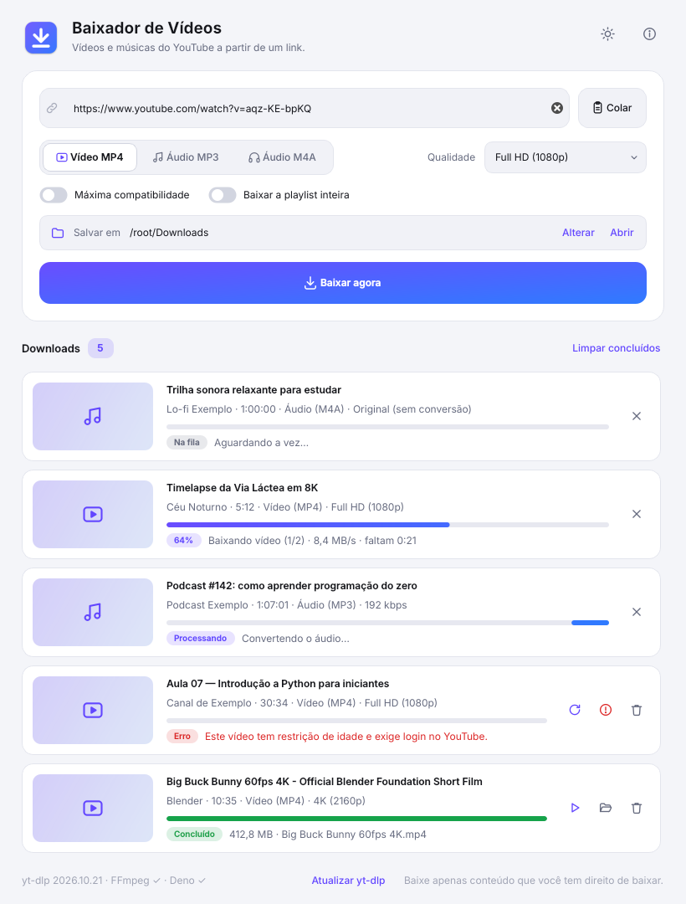

# Baixador de Vídeos

App de desktop para **Windows, macOS e Linux** que baixa vídeos e músicas do
YouTube (e de [centenas de outros sites](https://github.com/yt-dlp/yt-dlp/blob/master/supportedsites.md))
a partir de um link.

**[⬇ Baixar a versão mais recente](https://github.com/MatheuLB/Baixador-de-Videos-YT/releases/latest)**

| Tema escuro | Tema claro |
|---|---|
|  |  |

## O que ele faz

- Cola o link (ou arrasta para a janela) e clica em **Baixar agora**
- **Vídeo MP4** de 360p até 4K, com opção de *máxima compatibilidade* (H.264, abre em qualquer player)
- **Áudio MP3** (128/192/320 kbps) ou **M4A** sem perda, com capa e informações da música
- **Playlists inteiras**, salvas numa subpasta com o nome da playlist
- Fila com até 2 downloads ao mesmo tempo, progresso, velocidade e tempo restante
- Cancelar (apaga os arquivos parciais), tentar de novo, abrir o arquivo ou mostrar na pasta
- Tema claro, escuro ou automático (segue o sistema)
- Mensagens de erro em português ("vídeo privado", "restrição de idade" etc.)
- Atualiza o yt-dlp sozinho uma vez por dia. O YouTube muda com frequência, e isso evita que o app pare de funcionar

> **Atenção:** baixe apenas conteúdo que você tem direito de baixar: seus próprios
> vídeos, conteúdo de domínio público, com licença livre (Creative Commons) ou com
> autorização de quem tem os direitos. Os Termos de Serviço do YouTube proíbem
> downloads fora dos recursos oficiais da plataforma.

## Como funciona

O app é a interface. O trabalho pesado é feito por três programas livres, que
ele baixa sozinho na **primeira vez que abre** (cerca de 110 MB, uma vez só):

| Componente | Para quê |
|---|---|
| [yt-dlp](https://github.com/yt-dlp/yt-dlp) | Lê o link e baixa o vídeo |
| [FFmpeg](https://ffmpeg.org) | Junta vídeo + áudio (o YouTube envia separados acima de 720p) e converte para MP3 |
| [Deno](https://deno.com) | Runtime JavaScript que o yt-dlp exige para o YouTube |

Eles ficam numa pasta do seu usuário (não precisam de administrador):

- Windows: `%LOCALAPPDATA%\Baixador\bin`
- macOS: `~/Library/Application Support/Baixador/bin`
- Linux: `~/.local/share/baixador/bin`

Se o FFmpeg ou o Deno já estiverem instalados no sistema, o app usa os que já existem.

## Instalar

Baixe o arquivo do seu sistema na página de
**[Releases](https://github.com/MatheuLB/Baixador-de-Videos-YT/releases/latest)**:

| Sistema | Instalador | Extrair e usar |
|---|---|---|
| Windows 10/11 | `…-windows-x64-instalador.exe` | `…-windows-x64-portatil.zip` |
| Mac com chip Apple (M1 em diante) | `…-macos-apple-silicon.dmg` | `…-macos-apple-silicon.zip` |
| Mac com processador Intel | `…-macos-intel.dmg` | `…-macos-intel.zip` |
| Linux | `…-linux-x64.AppImage` | `…-linux-x64.tar.gz` |

Os arquivos "extrair e usar" trazem um `LEIA-ME.txt` com o passo a passo.

### Windows
Rode o `…-instalador.exe`. Ele não pede senha de administrador.
Ou extraia o `…-portatil.zip` e abra `Baixador\Baixador.exe`.

Na primeira vez, o Windows pode mostrar **"O Windows protegeu o computador"**
(SmartScreen), porque o app não tem certificado de assinatura pago. Clique em
**Mais informações → Executar assim mesmo**.

### macOS (12 Monterey ou mais novo)
Abra o `.dmg` (ou extraia o `.zip`) e arraste o **Baixador** para **Aplicativos**.
Para saber qual baixar: menu Apple → **Sobre Este Mac**. "Chip Apple M…" = `apple-silicon`,
"Processador Intel" = `intel`.

Como o app não é assinado pela Apple, o macOS bloqueia a primeira abertura. Para liberar,
o jeito mais garantido é rodar uma vez no Terminal:

```bash
xattr -cr /Applications/Baixador.app
```

Ou: tente abrir o app, feche o aviso, vá em **Ajustes do Sistema → Privacidade e Segurança**
e clique em **Abrir Mesmo Assim**.

### Linux
- **AppImage** (mais fácil): `chmod +x Baixador-*.AppImage` e abra. Se reclamar de FUSE,
  rode com `--appimage-extract-and-run`.
- **.tar.gz**: descompacte e rode `./install.sh`. Ele instala no menu de aplicativos
  só para o seu usuário. Para desinstalar: `~/.local/opt/baixador/install.sh --remover`.

Em algumas distribuições é preciso instalar `libxcb-cursor0` (Ubuntu/Debian:
`sudo apt install libxcb-cursor0`).

## Gerar os instaladores (GitHub Actions)

O workflow `.github/workflows/build.yml` gera tudo automaticamente nos servidores
do GitHub, um para cada sistema (o PyInstaller não faz build cruzado):

| Sistema | Arquivos gerados |
|---|---|
| Windows x64 | instalador `.exe` (Inno Setup) + `.zip` portátil |
| macOS Apple Silicon | `.dmg` + `.zip` |
| macOS Intel | `.dmg` + `.zip` |
| Linux x64 | `.AppImage` + `.tar.gz` |

1. Suba o projeto para um repositório no GitHub.
2. A cada push na `main`, os pacotes aparecem em **Actions → (execução) → Artifacts**.
3. Para publicar uma versão: altere `__version__` em `baixador/__init__.py` e crie uma tag:
   ```bash
   git tag v1.0.0
   git push origin v1.0.0
   ```
   O workflow cria uma **Release** com todos os instaladores anexados.

## Rodar a partir do código

Precisa de Python 3.10 ou mais novo.

```bash
python -m venv .venv
source .venv/bin/activate          # Windows: .venv\Scripts\activate
pip install -r requirements.txt
python run.py
```

Testes: `pip install -r requirements-build.txt && python -m pytest`

Build local (gera só para o sistema em que você está):

```bash
pip install -r requirements-build.txt
pyinstaller --noconfirm --clean baixador.spec
python scripts/package.py          # pacotes finais em dist/release/
```

Para conferir se o app empacotado abre: `dist/Baixador/Baixador --smoke-test`.

## Estrutura

```
baixador/
├── baixador/
│   ├── tools.py          # acha/baixa/atualiza yt-dlp, FFmpeg e Deno
│   ├── downloader.py     # monta o comando do yt-dlp e interpreta o progresso
│   └── gui/              # interface (PySide6 / Qt)
│       ├── main_window.py
│       ├── widgets.py    # cartão de download, barra animada, seletor, ícones
│       ├── manager.py    # fila de downloads
│       ├── setup_dialog.py
│       ├── theme.py      # cores, fonte Inter e estilo (claro/escuro)
│       └── icons.py
├── assets/               # ícone do app e fonte Inter
├── packaging/            # instalador do Windows, .desktop e install.sh do Linux
├── scripts/              # empacotamento e geração do ícone
├── tests/
└── baixador.spec         # receita do PyInstaller
```

## Problemas comuns

- **"O YouTube pediu uma verificação anti-robô"**: aguarde alguns minutos, clique em
  *Atualizar yt-dlp* no rodapé e tente de novo.
- **Vídeo com restrição de idade ou só para membros**: precisa de login no YouTube,
  o que o app não faz.
- **Algo parou de funcionar de repente**: quase sempre é uma mudança no YouTube.
  Clique em *Atualizar yt-dlp*.

## Créditos

[yt-dlp](https://github.com/yt-dlp/yt-dlp) (Unlicense), [FFmpeg](https://ffmpeg.org) (GPL,
builds estáticos do projeto [ffmpeg-static](https://github.com/eugeneware/ffmpeg-static)),
[Deno](https://deno.com) (MIT), [Qt for Python](https://www.qt.io/qt-for-python) (LGPL)
e a fonte [Inter](https://rsms.me/inter/) (SIL Open Font License).
